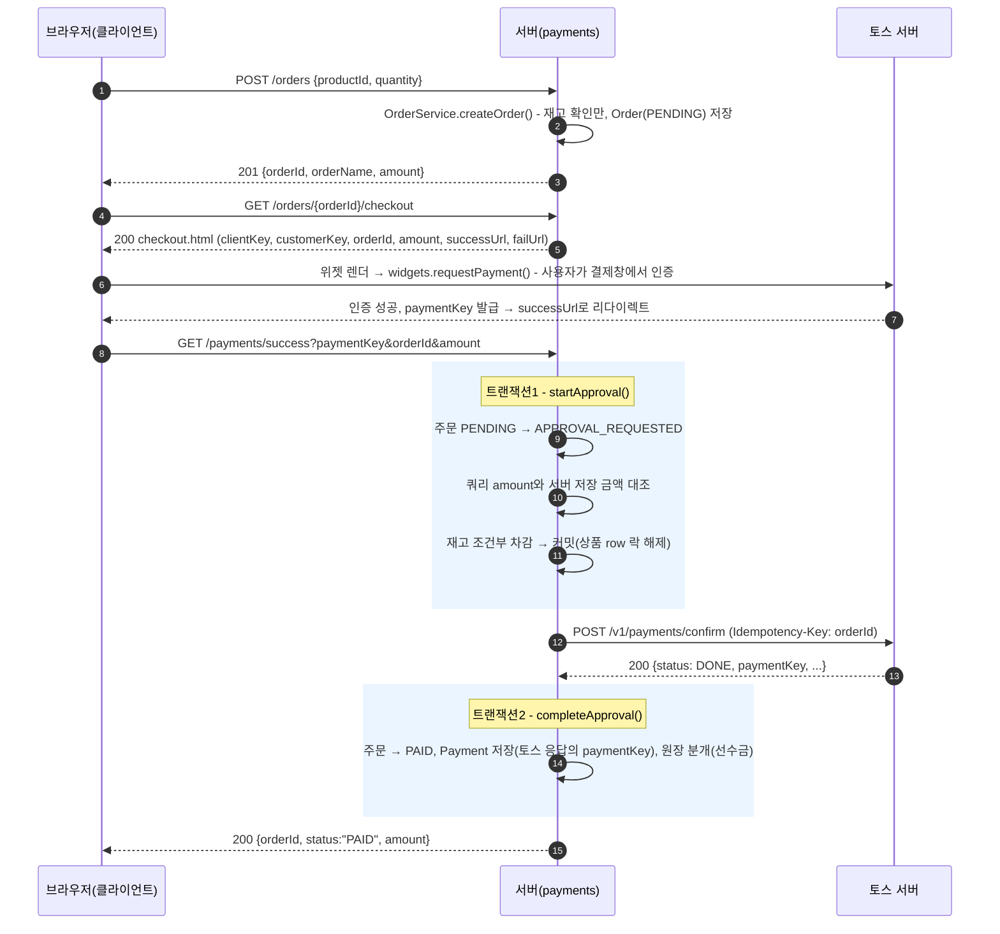
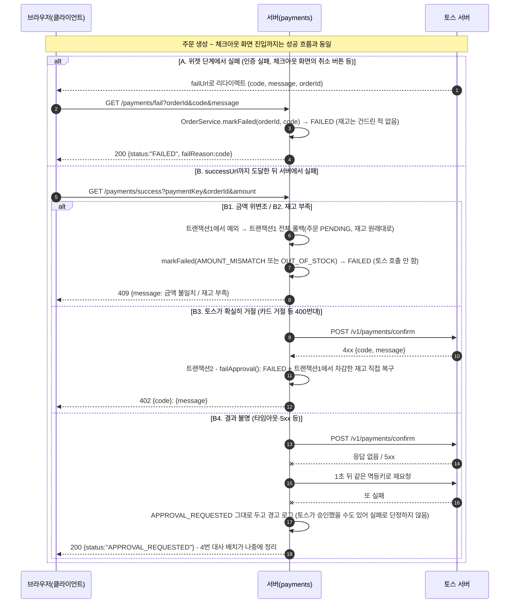
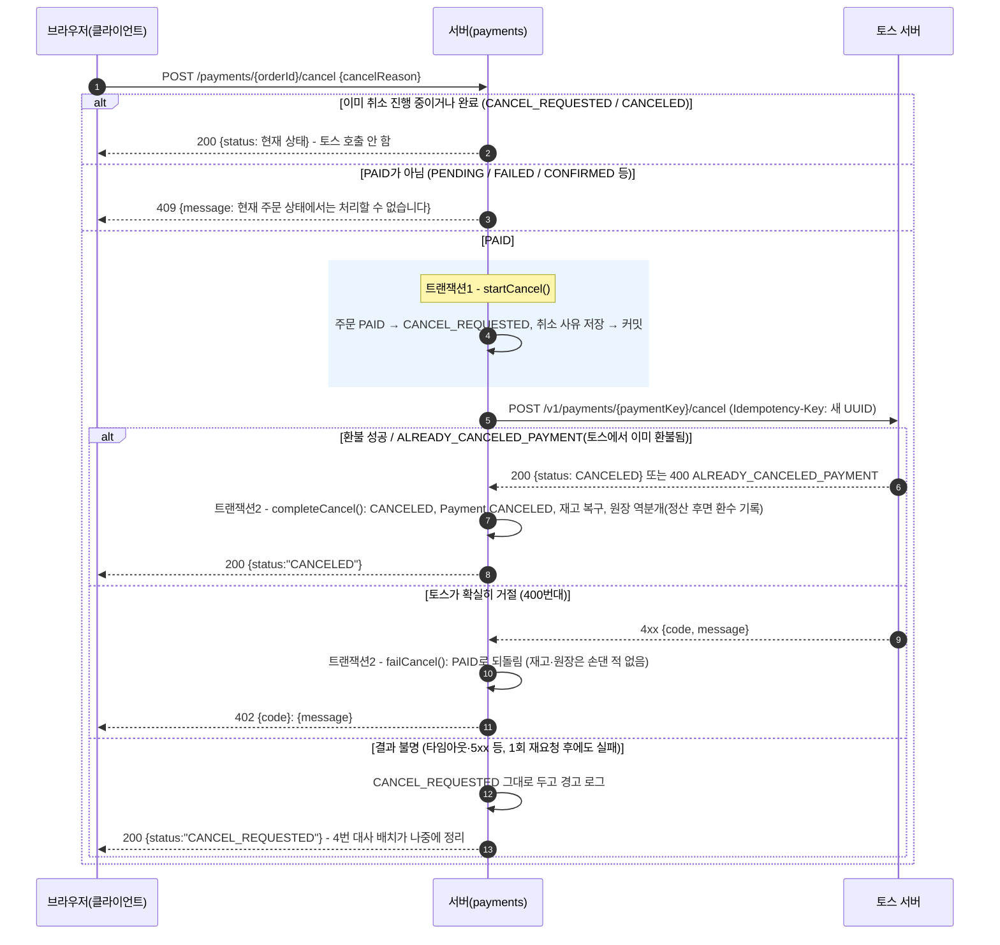
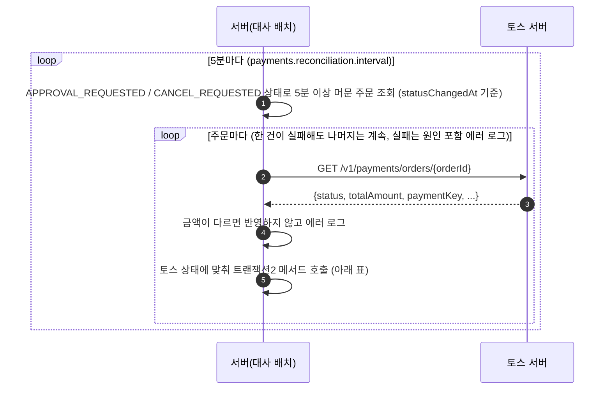

# 결제 승인·실패·취소·대사 흐름 시퀀스 다이어그램 & 테스트 가이드

참여자: **브라우저(클라이언트)** / **서버(payments)** / **토스 서버**

## 핵심 구조 한눈에 보기

승인과 취소는 모두 **"DB 트랜잭션1 → 토스 호출(트랜잭션 밖) → DB 트랜잭션2"** 3단계로 나뉜다. 토스 응답을 기다리는 동안 DB 락·커넥션을 잡지 않고, 중간에 문제가 생겨도 주문이 "진행 중" 상태로 남아 대사 배치가 나중에 정리한다.

| 단계 | 승인 (`PaymentApprovalProcessor`) | 취소 (`PaymentCancelProcessor`) |
|---|---|---|
| 트랜잭션1 | `startApproval`: `PENDING → APPROVAL_REQUESTED` + 금액 확인 + 재고 차감 | `startCancel`: `PAID → CANCEL_REQUESTED` + 취소 사유 저장 |
| 토스 호출 | 승인 요청 (멱등키 = `orderId`) | 환불 요청 (멱등키 = 시도마다 새 UUID) |
| 트랜잭션2 성공 | `completeApproval`: `PAID` + Payment·원장 저장 | `completeCancel`: `CANCELED` + 재고 복구 + 원장/환수 |
| 트랜잭션2 확정 실패 | `failApproval`: `FAILED` + 재고 복구 | `failCancel`: `PAID`로 되돌림 |
| 결과 불명 | `APPROVAL_REQUESTED` 그대로 → 대사 배치가 정리 | `CANCEL_REQUESTED` 그대로 → 대사 배치가 정리 |

**토스 응답 분류** (승인·취소 공통)

| 토스 응답 | 재요청 | 처리 |
|---|---|---|
| 성공 | - | 성공 처리 |
| 400번대 업무 에러 (카드 거절, 취소 불가 등) | 안 함 | 확정 실패 |
| 응답 못 받음 (타임아웃·연결 실패), 5xx, `IDEMPOTENT_REQUEST_PROCESSING` | 1초 뒤 같은 멱등키로 1회 | 재요청도 실패하면 결과 불명 |
| `ALREADY_PROCESSED_PAYMENT` (승인) | 안 함 | 결과 불명 |
| `ALREADY_CANCELED_PAYMENT` (취소) | 안 함 | 토스에선 이미 환불됨 → 취소 완료 처리 |

응답 대기 제한은 승인·취소 5초, 연결 1.5초라 최악의 사용자 대기는 약 11초(5 + 1 + 5)다.

## 1. 승인 성공 흐름



같은 주문에 success 콜백이 다시 오면(새로고침 등) 주문이 이미 `APPROVAL_REQUESTED`/`PAID`라 토스를 다시 호출하지 않고 현재 상태를 돌려준다.

## 2. 승인 실패 흐름



트랜잭션1이 이미 커밋된 뒤(B3)에는 롤백으로 재고를 되돌릴 수 없어서 `failApproval`이 직접 복구한다. B1·B2는 트랜잭션1 안에서 실패하므로 롤백만으로 원래대로 돌아간다.

## 3. 취소(환불) 흐름



- `paymentKey`는 승인 때 토스 **응답**에서 받아 Payment에 저장해 둔 값이라 믿을 수 있다(브라우저가 넘긴 값이 아님).
- 멱등키를 시도마다 새로 만드는 이유: 확실히 거절돼 `PAID`로 돌아간 주문을 나중에 다시 취소할 때 같은 키를 쓰면, 토스가 첫 거절 응답을 15일간 그대로 돌려주기 때문이다.
- `CANCEL_REQUESTED` 동안은 `PAID`가 아니라서 구매확정이 막힌다.

## 4. 대사 배치 흐름

대사(reconcile)는 우리 DB와 토스의 기록을 맞대어 비교하고, 다르면 토스 쪽에 맞추는 작업이다. 결제 상태는 토스가 기준이고, 주문 번호·금액은 우리 DB가 기준이다.



| 우리 상태 | 토스 상태 | 처리 |
|---|---|---|
| `APPROVAL_REQUESTED` | `DONE` | `completeApproval` → `PAID` |
| | `ABORTED`, `EXPIRED` | `failApproval` → `FAILED` + 재고 복구 |
| | `IN_PROGRESS` 등 (아직 승인 전) | 그대로 둠 (토스가 시간이 지나 `EXPIRED`로 바꾸면 다음 배치에서 정리) |
| `CANCEL_REQUESTED` | `CANCELED` | `completeCancel` → `CANCELED` |
| | `DONE` (환불 안 됨) | `failCancel` → `PAID` |
| | 그 외 (부분 취소 등) | 그대로 둠 + 경고 로그 |
| 공통 | 조회 실패(404 등), 금액 불일치 | 그대로 둠 + 에러 로그, 다음 배치에서 다시 시도 |

- 평소엔 대상이 0건이라 DB 조회 1번으로 끝나고 토스와 통신하지 않는다.
- 막 처리 중인 주문을 건드리지 않도록 "상태가 바뀐 지 5분 이상"인 주문만 고른다(`reconcile-after`). 원래 요청은 길어야 약 11초면 끝난다.
- 트랜잭션2 메서드는 진행 중 상태일 때만 동작하므로, 원래 요청과 배치가 겹쳐도 먼저 반영한 쪽만 적용된다.

## 5. 테스트 방법

공통: `./gradlew bootRun`으로 서버 기동(기본 8080). 실행에 필요한 환경변수는 README 참고.

### 승인 성공

1. 주문 생성해서 `orderId` 확보
   ```bash
   curl -X POST localhost:8080/orders -H "Content-Type: application/json" -d '{"productId":1,"quantity":1}'
   ```
2. 브라우저에서 `http://localhost:8080/orders/{orderId}/checkout` 접속 → 위젯 안내대로 테스트 결제(실청구 없음)
3. `/payments/success`로 자동 이동, `{"status":"PAID", ...}` 확인
4. DB에서 `orders.status = PAID`, `payment` 테이블에 새 row(`status = DONE`) 확인
5. 같은 success URL을 새로고침해도 `PAID`가 그대로 오고 토스를 다시 호출하지 않는지 확인

### 승인 실패

**A. 위젯 단계 실패** — 체크아웃 화면의 **취소** 버튼 → `/payments/fail`로 이동하며 `{"status":"FAILED", ...}` 확인
(결제창을 그냥 닫으면 failUrl로 가지 않고 알림만 뜨며, 주문은 `PENDING`으로 남아 다시 결제할 수 있다)

**B1. 금액 위변조** — success 콜백을 흉내 내되 `amount`만 다르게
```bash
curl "localhost:8080/payments/success?paymentKey=아무값&orderId={실제orderId}&amount=1"
# → 409, "결제 금액이 일치하지 않습니다"
```

**B2. 재고 부족** — 다른 주문이 먼저 재고를 가져간 상황을 DB에서 재현
```bash
mysql -uroot -p toss -e "UPDATE product SET stock_quantity=0 WHERE id={productId};"
curl "localhost:8080/payments/success?paymentKey=아무값&orderId={실제orderId}&amount={정상금액}"
# → 409, "재고가 부족합니다". 재고는 강제로 넣은 0 그대로(차감 자체가 안 일어남)
```

**B3. 토스 거절** — 존재하지 않는 `paymentKey`로 승인 유도(실제 토스 서버가 400번대로 거절)
```bash
curl localhost:8080/products   # 호출 전 재고 기록
curl "localhost:8080/payments/success?paymentKey=존재하지않는키&orderId={실제orderId}&amount={정상금액}"
# → 402, 예: "NOT_FOUND_PAYMENT_SESSION: ..."
curl localhost:8080/products   # failApproval이 재고를 직접 복구해 호출 전과 같은지 비교
```

**B4. 결과 불명** — 실제 토스로는 타임아웃·5xx를 일으키기 어려워, 응답을 지연시키거나 5xx를 돌려주는 가짜 토스 서버로 `TOSS_PAYMENTS_BASE_URL`을 바꿔 확인한다. 주문이 `APPROVAL_REQUESTED`로 남고, 가짜 서버에 같은 `Idempotency-Key`로 요청이 2번 오는지 본다.

### 취소(환불)

정상 케이스 — `PAID` 주문 취소
```bash
curl -X POST localhost:8080/payments/{PAID상태orderId}/cancel -H "Content-Type: application/json" -d '{"cancelReason":"단순 변심"}'
# → 200, {"status":"CANCELED", ...}
```
DB에서 `orders.status = CANCELED`, `payment.status = CANCELED`, 재고 복구 확인. 같은 요청을 한 번 더 보내면 200 + `CANCELED`가 그대로 오고 토스를 호출하지 않는다.

상태 가드 — `PENDING`/`FAILED`/`CONFIRMED` 주문 취소 시도
```bash
curl -X POST localhost:8080/payments/{PENDING상태orderId}/cancel -H "Content-Type: application/json" -d '{"cancelReason":"단순 변심"}'
# → 409, "현재 주문 상태에서는 처리할 수 없습니다"
```

### 대사 배치

결과 불명 상황을 만들려면 B4처럼 가짜 토스 서버가 필요하다. 기다리지 않도록 주기와 기준 시간을 줄여 실행한다.
```bash
PAYMENTS_RECONCILIATION_INTERVAL=2s PAYMENTS_RECONCILIATION_RECONCILE_AFTER=8s ./gradlew bootRun
```
결과 불명으로 남긴 주문이 기준 시간이 지난 뒤 가짜 서버의 조회 응답(`GET /v1/payments/orders/{orderId}`)에 맞춰 위 표대로 바뀌는지 확인한다. 막 만든 진행 중 주문은 기준 시간 전엔 조회되지 않아야 한다.
